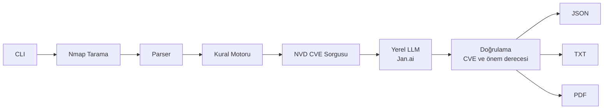
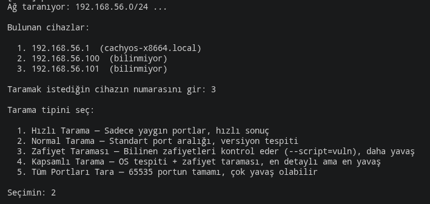
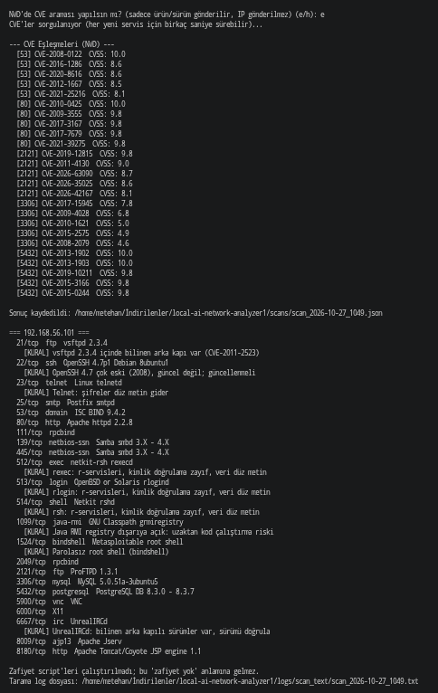
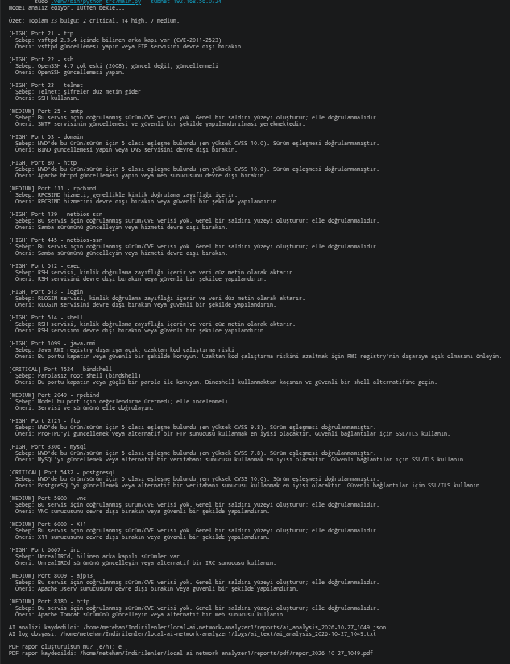
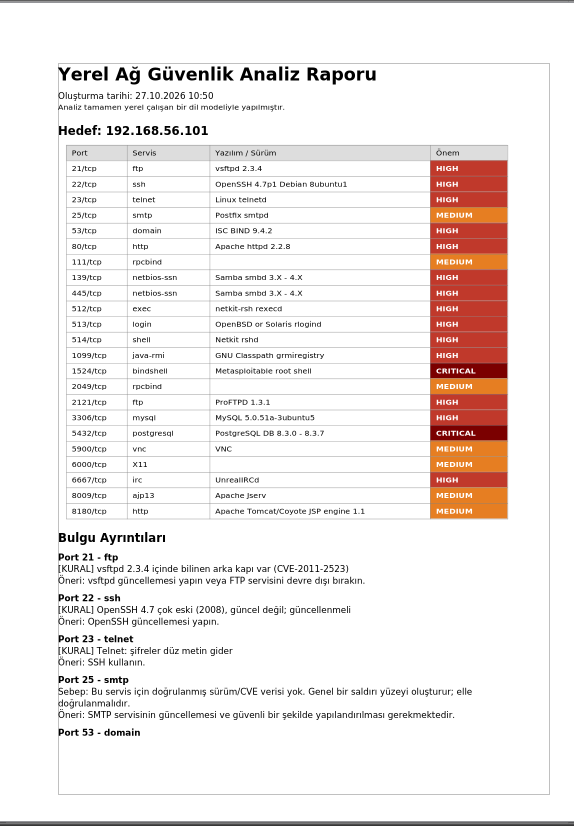

# Yapay Zeka Destekli Yerel Ağ Zafiyet Analiz ve Raporlama Aracı

Nmap ile ağdaki cihazları tarayan, sonuçları **buluta göndermeden**, tamamen yerelde çalışan bir yapay zeka modeliyle yorumlayıp okunabilir raporlara dönüştüren Python tabanlı bir CLI aracıdır.

## Problem ve Amaç

Nmap çıktılarını yorumlamak zaman alır ve siber güvenlik bilgisi gerektirir. Bulut tabanlı yapay zeka asistanları kullanılırsa ağ topolojisi gibi hassas bilgiler dış sunuculara gider. Bu proje analizi yerel bir LLM (Jan.ai üzerinde çalışan Qwen2.5-Coder-7B) ile yaparak bu riski ortadan kaldırır.

## Özellikler

- Yerel ağda cihaz keşfi ve numarayla hedef seçimi
- 5 tarama profili: hızlı, normal, zafiyet (NSE), kapsamlı, tüm portlar
- Kural motoru: bilinen kritik durumlar (bindshell, Telnet, vsftpd 2.3.4 vb.) sabit kurallarla işaretlenir
- NVD üzerinden CVE eşleştirmesi (isteğe bağlı, sadece ürün/sürüm gönderilir)
- Yerel LLM ile Türkçe risk analizi ve öneriler (portlar gruplar halinde işlenir)
- Çıktılar: JSON, TXT log ve PDF rapor

## Mimari

```text
CLI → Nmap → Parser → Kural Motoru → [NVD CVE] → Yerel LLM (Jan.ai) → JSON / TXT / PDF
```



| Dosya | Görev |
|---|---|
| `src/main.py` | Giriş noktası, CLI akışı |
| `src/scanner.py` | Nmap taraması ve ağ keşfi |
| `src/parser.py` | Nmap çıktısını JSON'a çevirme |
| `src/rules.py` | Kural motoru |
| `src/cve_lookup.py` | NVD CVE sorgusu ve önbellek |
| `src/ai_client.py` | Yerel LLM ile iletişim, prompt |
| `src/reporter.py` | PDF rapor üretimi |

## Gereksinimler

- Linux (CachyOS/Arch üzerinde test edildi), Python 3.11+
- Nmap
- Jan.ai ve bir GGUF model (örn. `qwen2.5-coder-7b-instruct-q4_k_m`)
- PDF fontu (DejaVu) projeyle birlikte gelir (assets/fonts/)

## Kurulum

```bash
git clone https://github.com/Metehan-Bilir-dev/local-ai-network-analyzer.git
cd local-ai-network-analyzer
python -m venv .venv
source .venv/bin/activate        # fish: source .venv/bin/activate.fish
pip install -r requirements.txt
```

1. Jan'ı aç, modeli indir, **Settings → Local API Server → Start Server**.
2. Model adını öğren: `curl http://127.0.0.1:1337/v1/models`
3. `config/config.json` dosyasını düzenle:

```json
{
    "ai_api_url": "http://127.0.0.1:1337/v1/chat/completions",
    "ai_model": "qwen2_5-coder-7b-instruct-q4_k_m"
}
```

## Kullanım

```bash
sudo .venv/bin/python src/main.py
sudo .venv/bin/python src/main.py --subnet 192.168.56.0/24
sudo .venv/bin/python src/main.py --target 192.168.56.101 --ai
```

Akış: cihaz seç → tarama profili seç → (CVE sorgusu?) → (AI analizi?) → (PDF rapor?)

OS tespiti (`-O`) ve bazı taramalar root yetkisi gerektirir.

## Çıktı Klasörleri

| Klasör | İçerik |
|---|---|
| `scans/` | Ham tarama JSON |
| `reports/` | AI analizi JSON |
| `reports/pdf/` | PDF raporlar |
| `logs/scan_text/`, `logs/ai_text/` | Okunabilir metin özetleri |
| `cve_cache/` | NVD önbelleği |

## Gizlilik ve Güvenlik Tasarımı

- Tarama verisi yalnızca yerel LLM'e gider, buluta çıkmaz.
- NVD sorgusunda yalnızca ürün/sürüm bilgisi internete çıkar, IP adresi gönderilmez. Sorgu kullanıcı onayına bağlıdır.
- Nmap çıktısı LLM'e güvenilmeyen veri olarak bildirilir. **Test sonucu:** yalnızca prompt uyarısı yeterli olmadı; banner alanına yerleştirilen talimat 5 denemenin 5'inde modeli etkiledi (zehirli portlarda 15/15) ve aynı istekteki temiz bir porta da bulaştı. Bu yüzden iki katman eklendi: (1) banner/sürüm alanları modele gönderilmeden önce temizlenir, (2) önem derecesine kural bulgusu ve CVSS'e göre koddan alt sınır konur. Aynı testte etkilenen sayısı 0/15'e düştü. Test tek bir payload türüyle ve tek modelle yapılmıştır; kesin koruma sağladığı iddia edilmez.
- Kural bulgusu olan portların önem derecesi, modele bırakılmadan koddan zorlanır.
- Modelin yazdığı CVE numaraları NVD kayıtlarıyla karşılaştırılır; doğrulanamayanlar çıktıdan silinir.

## Test Ortamı

Araç, VirtualBox üzerinde **Host-Only** ağda çalışan Metasploitable 2 ve kendi cihazlarım üzerinde test edilmiştir.






## Bilinen Sınırlamalar

- 7B yerel model hata yapabilir (örn. yanlış öneri, abartılı ifadeler); çıktılar doğrulanmalıdır.
- NVD'den gelen CVE'ler sürüm için doğrulanmış değil, olası eşleşmedir. Her servis için CVSS'e göre ilk 5 kayıt tutulur.
- Zafiyet script'leri çalıştırılmadıysa "bulgu yok" sonucu "güvenli" anlamına gelmez.
- NVD sorgusu internet gerektirir.
- 7B model prompt talimatlarına tam uymaz (örn. "arka kapı" ifadesini gereksiz kullanabilir, eski sürümlü SSH için "güvenli görünüyor" diyebilir).
- CVE'li portların gerekçesi NVD verisinden kodla üretilir; modelin serbest metni yalnızca CVE'siz portlarda ve önerilerde kullanılır.
- `src/test_injection.py` çalışması için önce en az bir tarama yapılmış olmalıdır (`scans/` klasörü repoya dahil değildir).
- Sürümü belirsiz servislerde (örn. Samba "3.X - 4.X") CVE eşleşmesi yapılamaz; bu servislerin önem derecesi model tahminidir.

## Gelecek Çalışmalar

- NVD verisinin yerelde indirilip tamamen offline çalışma
- NVIDIA NIM gibi ikinci bir AI backend (`--ai-backend`)
- Taramalar arası karşılaştırma (diff)

## Yasal Uyarı

Bu araç yalnızca **sahibi olduğunuz veya yazılı izin aldığınız** sistemlerde kullanılmalıdır. İzinsiz tarama yasa dışı olabilir. Eğitim amaçlı geliştirilmiştir.
